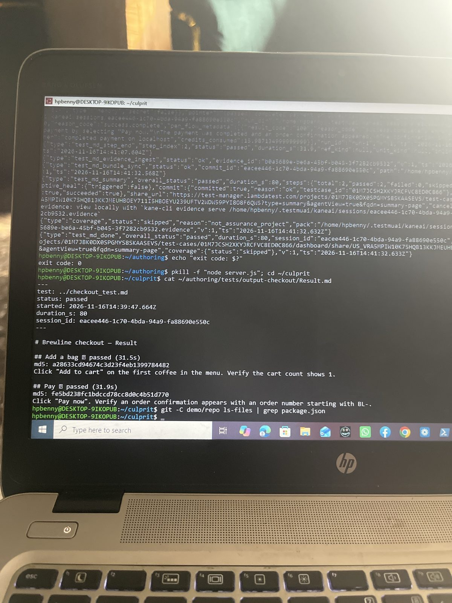
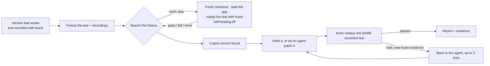

<div align="center">

# 🔎 Culprit

**An agent made 20 commits today. One silently broke checkout. Which one?**

Culprit finds the commit that broke your app. It replays a recorded [Kane CLI](https://www.npmjs.com/package/@testmuai/kane-cli) browser test across your git history, undoes the bad commit, and replays the same test to prove checkout works again. If a plain undo doesn't work, it hands Kane's failure evidence to an agent, and Kane re-checks whatever the agent changes. Nothing is kept that Kane did not confirm.

**▶ Demo video: YOUTUBE_LINK_HERE**

**[▶ Try it live](https://culprit-kane.duckdns.org/app)** · [Project site](https://culprit-kane.duckdns.org/) · [Watch the recorded real run](https://culprit-kane.duckdns.org/r/real-nov16) · [Sample report](https://culprit-kane.duckdns.org/report/)

</div>

## For judges: 60 seconds

1. Open **https://culprit-kane.duckdns.org**. The badge at the top says **REAL KANE** (every check is a real Kane replay).
2. Click **Watch the recorded real run** for instant real timings, or **Run the demo** to watch a live search over 16 commits (a few minutes).
3. Or use **Try it, Your repo** with `https://github.com/BenCoy09/launchlist-demo`, pick the commit `feat: add footer` as the last good one, and use these steps:
   `Type test@example.com in the email field and click "Sign up".`
   `Check the message "Thanks, you're on the list." appears on the page.`
4. What to look for, matching the scoring:
   - **Verified:** the test is replayed 10/10 on the good version and 10/10 on the bad one before any search (`gate0-result.txt`); self-healing is off; the answer is confirmed twice.
   - **Closed loop:** culprit named, plain undo tried, agent patch applied, the **same frozen recording** replayed by Kane, up to 3 tries with Kane's failure evidence fed back.
   - **Can't cheat:** a patch that edits the test files is rejected (covered by the test suite).

**Scope, honestly:** other people's repos must be static sites. Repos from owners listed in `TRUSTED_OWNERS` can also run a small Node app (`culprit.json`), because running strangers' code on the server would be unsafe. Next: sandboxed app runs.

```bash
npx github:BenCoy09/culprit run --repo . --test tests/checkout_test.md --good <sha> --bad HEAD \
  --app "node server.js" --fix
```

> **Real vs demo, up front.** The Kane results below are real, recorded on Nov 16, 2026, and the website replays that exact run with its real timings (**Watch the recorded real run**). The live site has two modes, and a badge on every page says which one it is in: **Real Kane**, where every check is a real Kane replay (this is what the live site runs), and **Stand-in**, where search, undo and verify are real but browser replays are simulated. The demo shop's commit history is made up, with one planted bug.

## Use it in the browser (no terminal)

Open the site and pick one of three things:

1. **Demo shop.** One click. Culprit searches 16 commits live, names the culprit, fixes it, and has Kane prove the fix. Every check shows up as it happens.
2. **Your repo.** Paste a public GitHub repo, pick the last commit that worked, and describe the flow in plain English, one step per line. Kane records those steps on the good version, then Culprit searches, fixes and proves. You get the culprit, the exact diff, a verified `.patch` you can download, and a link you can share. Works for static sites (HTML, CSS and JavaScript with an `index.html` in the root or in `public`, `docs`, `dist` or `build`). Culprit never installs or builds your code.
3. **Recorded real run.** The full Nov 16 run with real timings, instantly and for free.

Safety, since strangers can use it: only public `github.com` links are accepted, repos are shallow-cloned with size and time limits, your code only ever runs inside the browser sandbox (no install, no build, no server code), credentials never reach the process that serves your site, every POST must come from the site's own pages, and each visitor has a daily run limit.

---

## Real results (real Kane, real runs)

| What | Result |
|---|---|
| Checkout test recorded once with Kane (`testmd`), 2 steps | **Passed**; Kane's auto-repair was not triggered |
| **Reliability check:** replay the test 10 times on the good version and 10 times on the broken one | **Good: 10/10 pass. Broken: 10/10 fail. 0 errors.** |
| Cost and speed of a replay | About 12 seconds each, no re-recording |
| Kane CLI smoke test (`kane-cli run`, 0.10.4) | Run ended **passed**, 11.99 credits, evidence pack saved |

<p align="center">
  
</p>
<p align="center">
  
  
</p>
<p align="center">
  
  
</p>

Raw output is committed: [`gate0-result.txt`](gate0-result.txt) (the reliability check) and [`run-result.txt`](run-result.txt) (the search).


## Proven end to end on a repo Culprit had never seen

`BenCoy09/launchlist-demo` is a separate public repo (a small waitlist page, 4 commits, one AI-style "refactor" that silently broke the sign-up form). It was run through the **live site** from a phone, with real Kane and a free-tier agent (`gpt-oss-120b` on Cerebras):

| Step | Real result |
|---|---|
| Steps typed in plain English | "Type test@example.com in the email field and click Sign up. Check the message 'Thanks, you're on the list.' appears." |
| Kane records them on the last good commit | passed |
| Culprit searches the history | named `ead3ba2` "refactor: use querySelector for the form", confirmed twice |
| Plain undo | did not apply cleanly (later commits overlap) |
| Agent patch | `edeb98d` "fix form selector", re-verified by Kane on the same frozen recording: **passes** |
| Whole run | **7 min 05 s, 8 real Kane checks** |

**Node apps too (trusted-owner mode).** `BenCoy09/nodeapp-demo` is a small Node server with an API. An AI-style refactor ("rename total route") renamed `/api/total`, so the page's button silently stopped working. On the live site, real Kane recorded the flow on the last good commit, Culprit named `fe589b8` as the culprit, undid it with a plain `git revert`, and Kane replayed the same frozen recording and passed (about 6 minutes, real checks). This mode only runs for repos owned by accounts listed in `TRUSTED_OWNERS`, because running strangers' code on the server would be unsafe.

The same agent-patch path was also run on the demo shop's harder seed, where a plain undo conflicts: the agent's patch passed Kane. Nothing here is simulated.

## How it works



Replays reuse the recording, so each check takes seconds and needs no AI model. That is what makes searching a browser flow practical: 4 checks instead of up to 15 for the demo history.

## The closed loop (`--fix`)

Kane's result decides what happens next, and Kane checks the outcome.

| Step | What happens |
|---|---|
| 1 | Culprit tries a plain `git revert` of the culprit. Kane replays the frozen test on it. If it passes, done. |
| 2 | If the undo conflicts with later commits (common after a busy day of agent commits), the agent gets the culprit's diff, Kane's failing step, Kane's result notes and the current files. |
| 3 | The agent's patch is committed and Kane replays the same recorded test on it. |
| 4 | If Kane says it still fails, the patch is rolled back and the agent gets what it tried plus what Kane said. Up to `--attempts` tries (default 3). |
| 5 | A patch that touches the test files is rejected, so an agent can't "fix" a bug by weakening the test. |

Every attempt, its Kane verdict, the Kane run link (when Kane prints one) and the saved evidence pack end up in the report.

## Why you can trust the answer

- **Self-healing is off.** Kane can auto-repair a broken test step, which could turn a real bug into a pass. Every check runs with `--no-adaptive-heal`.
- **Errors are never blamed on a commit.** If Kane errors or times out, that check is skipped. Culprit stops rather than accuse a commit.
- **The test is frozen** from the good version. Each check tests the app, not the test.
- **The test can't be weakened.** A fix that edits the test files is rejected.
- **Reliability first.** `culprit gate0` replays the test 10 times on each side, so you know it isn't flaky before you trust a search.
- **The answer is confirmed twice.** If the checks disagree, Culprit reports "inconclusive" instead of guessing.

## Run it yourself

```bash
npm i -g @testmuai/kane-cli && kane-cli login --username <u> --access-key <k>

bash gate0.sh        # build the demo repo, record the test once with real Kane, freeze it, run the reliability check
bash run-demo.sh     # search + undo + re-verify + one-by-one baseline (no model key needed)
```

On your own repo:

```bash
npx github:BenCoy09/culprit run --repo . --test tests/checkout_test.md --good <sha> --bad HEAD \
  --app "node server.js" --fix --baseline --evidence culprit-report/evidence
```

Commit the test's `output-*/` recordings at the good version, or pass `--bundle <dir>`. `--fix` is opt-in because it commits to your repo. Bare `--fix` means `auto` (undo if Kane confirms it, otherwise the agent loop). `--fix revert`, `--fix agent` and `--attempts N` are also available.

### The agent: any model, including free tiers

The agent loop needs one model endpoint. Any OpenAI-compatible endpoint works, including free tiers:

```bash
export FIX_API_URL=https://generativelanguage.googleapis.com/v1beta/openai/chat/completions
export FIX_API_KEY=<free key from Google AI Studio>
export MODEL=<a model name from your provider>
npx github:BenCoy09/culprit run ... --fix
```

Groq, OpenRouter and a local Ollama (`http://localhost:11434/v1/chat/completions`) use the same three variables. With `ANTHROPIC_API_KEY` set and no `FIX_API_URL`, the Anthropic API is used. Free tiers may use prompts to improve the provider's products, so use them on non-sensitive code.

### Trusted-owner app mode (optional, off by default)

Visitors' repos are always served as static sites. For repos owned by accounts you list in `TRUSTED_OWNERS` (for example `TRUSTED_OWNERS=BenCoy09`), Culprit can also start a small Node app. The repo needs a `culprit.json` at the root: `{"start": "node server.js"}`. The only command allowed is `node <file in the repo>`; there is no install step, and the app must listen on `process.env.PORT`. Everyone else's repos stay static-only. Sample: a four-commit Node app where a refactor renames an API route.


## Deploy the website

The repo has a `Dockerfile` and the site starts with `node web.mjs`. On any host that runs Docker, set these environment variables:

| Variable | What for |
|---|---|
| `REAL_KANE=1` | Turns on real Kane replays. Leave it out for stand-in mode. |
| `KANE_BIN=/app/kane-wrapper.sh` | How to call Kane. It adds your login from the next two variables. |
| `LT_USERNAME`, `LT_ACCESS_KEY` | Your TestMu / LambdaTest login for Kane. Keep them in the server environment only, never in the repo. |
| `FIX_API_URL`, `FIX_API_KEY`, `MODEL` | Optional. Any OpenAI-compatible endpoint (or `ANTHROPIC_API_KEY`) switches on the agent. Without it, the fix is a plain `git revert`. |
| `DAILY_CAP`, `PER_IP_CAP` | Optional. Runs per day in total (default 30) and per visitor (default 4). |
| `RUN_PASSWORD` | Optional. Asks visitors for a code before starting a run. |
| `STABILITY` | Optional. How many times each end of the range is checked before searching (default 1 in real mode). |
| `TRUSTED_OWNERS` | Optional. Comma-separated GitHub owners whose repos may start a Node app (see above). Empty by default. |
| `DATA_DIR` | Optional. Where runs are saved (default `./data`). |

Real mode needs the recorded test bundle in `frozen/` (created once by the `author-frozen` workflow). Kane's browser needs more than 512 MB, so the live site runs on a small AWS EC2 instance (Docker, bound to localhost, Caddy for HTTPS). `GET /health` is a good target for an uptime pinger.

## Honest limits

- **In stand-in mode the live site simulates Kane's browser replays.** It validates Culprit's logic, not Kane's behaviour. In real mode every check is a real replay; the recorded real run and the results above are real Kane.
- **Your own repo needs real mode and a static site.** Kane authors your plain-English steps on the version you say worked, and the first authoring can fail if the steps are vague. The site then says what Kane reported instead of guessing.
- **A real run takes minutes, not seconds** (each replay is 20 to 70 seconds), so runs are queued one at a time and capped per visitor.
- **The agent loop has been run end to end with real Kane** (see the proof above), but on small static demos with one free-tier model. That shows the loop works, not how any model does on large codebases. The unit tests use a scripted stand-in agent.
- **`npm test` (20 tests)** runs against `demo/fake-kane.mjs`, the same stand-in. The website tests cover the API, the guards, the queue and the file server's path safety.
- Kane's evidence packs and run links are saved only when Kane writes them. Fields Kane doesn't print stay empty and are never invented.
- **The demo history is made up:** 16 commits, one planted bug. The check counts for search vs one-by-one are measured in the same harness.
- Only first-parent history is searched, and the bug must stay once it appears. One test file and one app command per run.
- Not verified: whether `--on-lock-conflict readonly` is needed to avoid checks uploading to Kane.
