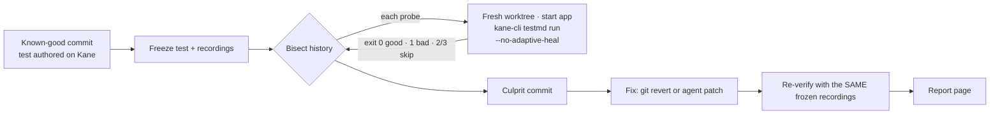

<div align="center">

# 🔎 Culprit

**An agent made 20 commits today. One silently broke checkout. Which one?**
Culprit finds it by replaying a recorded [Kane CLI](https://www.npmjs.com/package/@testmuai/kane-cli) test across your git history, then proves the fix with the same test.

</div>

**[Live site](https://bencoy09.github.io/culprit/)** · [Replay the real run](https://bencoy09.github.io/culprit/live.html) · [Run report](https://bencoy09.github.io/culprit/report/)

---

## Proof (real Kane, real runs)

| What | Result |
|---|---|
| Test authored once on Kane (`testmd`), 2 steps | **passed**, adaptive heal not triggered |
| **Gate 0**: replay the frozen test 10× at the good commit and 10× at the bad commit | **good 10/10 pass, bad 10/10 fail, 0 errors** |
| Replay cost and speed | ~12 s per replay, no re-authoring |
| Kane CLI smoke test (`kane-cli run`, 0.10.4) | `run_end` **passed**, 11.99 credits, evidence pack saved |

<p align="center">
  
</p>
<p align="center">
  
  
</p>
<p align="center">
  
  
</p>

Raw output is committed: [`gate0-result.txt`](gate0-result.txt), [`run-result.txt`](run-result.txt).

## How it works



Replays reuse recordings, so a probe costs seconds and no model calls. That is what makes bisecting a browser flow practical.

## Why you can trust the answer

- **Healing is off.** Kane's adaptive healing could re-author a broken step and turn a real regression into a pass, so every probe runs with `--no-adaptive-heal`.
- **Errors are never blame.** Kane exit 2/3 (error, timeout) is a *skip*, never "bad". Culprit aborts rather than accuse a commit.
- **The test is frozen** from the good commit. Probes test the app, not the test.
- **Test-integrity guard.** A fix commit that touches the test bundle is rejected, so nothing can "fix" a bug by weakening the test.
- **Gate 0 first.** If replays are flaky, `culprit gate0` says so before you trust any bisect.
- **Boundary confirmed twice.** Disagreement is reported as "inconclusive", never guessed.

## Run it

```bash
npm i -g @testmuai/kane-cli && kane-cli login --username <u> --access-key <k>

bash gate0.sh        # seed demo repo, author the test once on real Kane, freeze it, run Gate 0
bash run-demo.sh     # bisect + revert fix + re-verify + linear-scan baseline (no model key needed)
```

Your own repo:

```bash
node bin/culprit.mjs run --repo . --test tests/checkout_test.md --good <sha> --bad HEAD \
  --app "node server.js" --fix revert --baseline
```

Commit the test's `output-*/` recordings at the good commit, or pass `--bundle <dir>`.

### Optional: agent fix with a free model

`--fix agent` asks a model for a small patch from the culprit diff and the failing step. Any OpenAI-compatible endpoint works, including free tiers:

```bash
export FIX_API_URL=https://generativelanguage.googleapis.com/v1beta/openai/chat/completions
export FIX_API_KEY=<free key from Google AI Studio>
export MODEL=<a model name from your provider>
node bin/culprit.mjs run ... --fix agent
```

Groq, OpenRouter and a local Ollama (`http://localhost:11434/v1/chat/completions`) use the same three variables. With `ANTHROPIC_API_KEY` set and no `FIX_API_URL`, the Anthropic API is used. Free tiers may use prompts to improve the provider's products, so use them on non-sensitive code.

## Honest limits

- `--fix agent` is covered by stubbed-API tests only; it has not been run against a real model yet.
- `npm test` (9 tests) runs against `demo/fake-kane.mjs`, a **stand-in** for Kane. It validates Culprit's logic, not Kane's behaviour. Real-Kane evidence is the Proof section above.
- The demo history is **seeded** (16 commits, one planted regression). Probe counts for bisect vs linear scan are measured in the same harness.
- First-parent history only; the regression must be monotonic. One test file and one app command per run.
- Not verified: whether `--on-lock-conflict readonly` is needed to avoid probe uploads to Kane.
