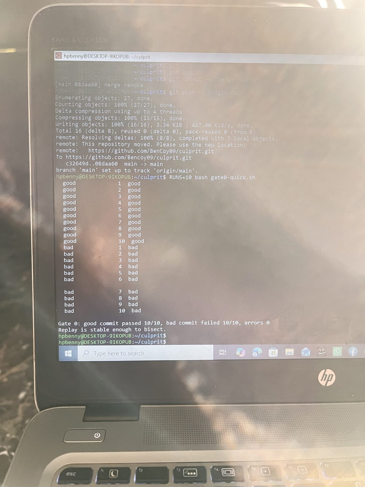
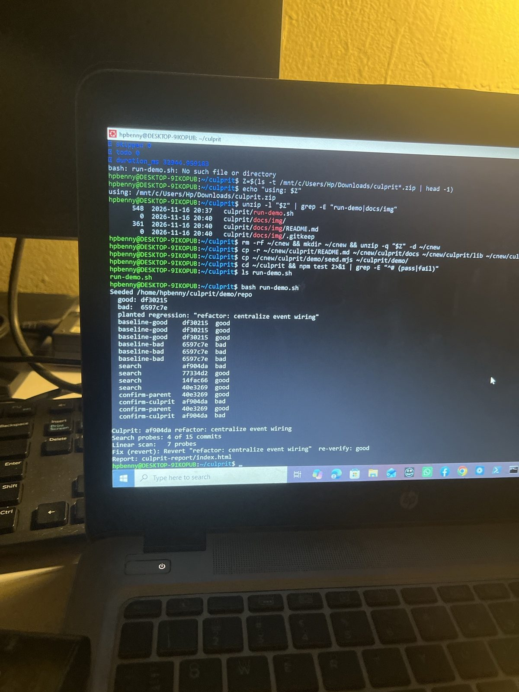
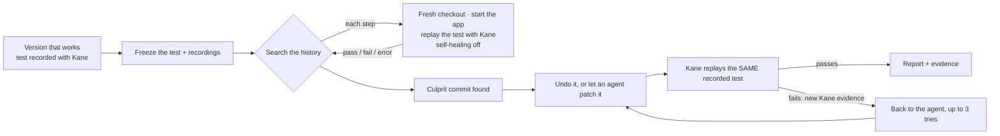

<div align="center">

# 🔎 Culprit

**An agent made 20 commits today. One silently broke checkout. Which one?**

Culprit finds the commit that broke your app. It replays a recorded [Kane CLI](https://www.npmjs.com/package/@testmuai/kane-cli) browser test across your git history, undoes the bad commit, and replays the same test to prove checkout works again. If a plain undo doesn't work, it hands Kane's failure evidence to an agent, and Kane re-checks whatever the agent changes. Nothing is kept that Kane did not confirm.

**[▶ Try it live](https://culprit-ig6e.onrender.com/try)** · [Project site](https://culprit-ig6e.onrender.com/) · [Watch a real run](https://culprit-ig6e.onrender.com/live.html) · [Sample report](https://culprit-ig6e.onrender.com/report/)

</div>

```bash
npx github:BenCoy09/culprit run --repo . --test tests/checkout_test.md --good <sha> --bad HEAD \
  --app "node server.js" --fix
```

> **Real vs demo, up front.** The Kane results below are real, recorded on Nov 16, 2026. The **Try it live** button runs Culprit's full search, undo and verify steps on a made-up 16-commit shop history, but it uses a **stand-in for Kane**, so it tests Culprit's logic, not real browser replays. The free server can take about a minute to wake up on the first visit.

---

## Real results (real Kane, real runs)

| What | Result |
|---|---|
| Checkout test recorded once with Kane (`testmd`), 2 steps | **Passed**; Kane's auto-repair was not triggered |
| **Reliability check:** replay the test 10 times on the good version and 10 times on the broken one | **Good: 10/10 pass. Broken: 10/10 fail. 0 errors.** |
| Cost and speed of a replay | About 12 seconds each, no re-recording |
| Kane CLI smoke test (`kane-cli run`, 0.10.4) | Run ended **passed**, 11.99 credits, evidence pack saved |

<p align="center">
  
</p>
<p align="center">
  
  
</p>
<p align="center">
  
  
</p>

Raw output is committed: [`gate0-result.txt`](gate0-result.txt) (the reliability check) and [`run-result.txt`](run-result.txt) (the search).

## How it works



Replays reuse the recording, so each check takes seconds and needs no AI model. That is what makes searching a browser flow practical: 4 checks instead of up to 15 for the demo history.

## The closed loop (`--fix`)

Kane's result decides what happens next, and Kane checks the outcome.

| Step | What happens |
|---|---|
| 1 | Culprit tries a plain `git revert` of the culprit. Kane replays the frozen test on it. If it passes, done. |
| 2 | If the undo conflicts with later commits (common after a busy day of agent commits), the agent gets the culprit's diff, Kane's failing step, Kane's result notes and the current files. |
| 3 | The agent's patch is committed and Kane replays the same recorded test on it. |
| 4 | If Kane says it still fails, the patch is rolled back and the agent gets what it tried plus what Kane said. Up to `--attempts` tries (default 3). |
| 5 | A patch that touches the test files is rejected, so an agent can't "fix" a bug by weakening the test. |

Every attempt, its Kane verdict, the Kane run link (when Kane prints one) and the saved evidence pack end up in the report.

## Why you can trust the answer

- **Self-healing is off.** Kane can auto-repair a broken test step, which could turn a real bug into a pass. Every check runs with `--no-adaptive-heal`.
- **Errors are never blamed on a commit.** If Kane errors or times out, that check is skipped. Culprit stops rather than accuse a commit.
- **The test is frozen** from the good version. Each check tests the app, not the test.
- **The test can't be weakened.** A fix that edits the test files is rejected.
- **Reliability first.** `culprit gate0` replays the test 10 times on each side, so you know it isn't flaky before you trust a search.
- **The answer is confirmed twice.** If the checks disagree, Culprit reports "inconclusive" instead of guessing.

## Run it yourself

```bash
npm i -g @testmuai/kane-cli && kane-cli login --username <u> --access-key <k>

bash gate0.sh        # build the demo repo, record the test once with real Kane, freeze it, run the reliability check
bash run-demo.sh     # search + undo + re-verify + one-by-one baseline (no model key needed)
```

On your own repo:

```bash
npx github:BenCoy09/culprit run --repo . --test tests/checkout_test.md --good <sha> --bad HEAD \
  --app "node server.js" --fix --baseline --evidence culprit-report/evidence
```

Commit the test's `output-*/` recordings at the good version, or pass `--bundle <dir>`. `--fix` is opt-in because it commits to your repo. Bare `--fix` means `auto` (undo if Kane confirms it, otherwise the agent loop). `--fix revert`, `--fix agent` and `--attempts N` are also available.

### The agent: any model, including free tiers

The agent loop needs one model endpoint. Any OpenAI-compatible endpoint works, including free tiers:

```bash
export FIX_API_URL=https://generativelanguage.googleapis.com/v1beta/openai/chat/completions
export FIX_API_KEY=<free key from Google AI Studio>
export MODEL=<a model name from your provider>
npx github:BenCoy09/culprit run ... --fix
```

Groq, OpenRouter and a local Ollama (`http://localhost:11434/v1/chat/completions`) use the same three variables. With `ANTHROPIC_API_KEY` set and no `FIX_API_URL`, the Anthropic API is used. Free tiers may use prompts to improve the provider's products, so use them on non-sensitive code.

## Honest limits

- **The live button uses a stand-in for Kane.** It validates Culprit's logic, not Kane's behaviour. Real-Kane evidence is the results section above.
- **The agent loop hasn't been run end to end with a real model and real Kane.** Its tests use a scripted stand-in agent, so they prove the loop, not any model's skill. The `real-run` workflow is built to do exactly that, and its output, once run, is the evidence.
- **The real-Kane results were recorded on a history where a plain undo applies cleanly.** The harder seed (where the undo conflicts and the agent is needed) hasn't been replayed on real Kane yet.
- **`npm test` (15 tests)** runs against `demo/fake-kane.mjs`, the same stand-in.
- Kane's evidence packs and run links are saved only when Kane writes them. Fields Kane doesn't print stay empty and are never invented.
- **The demo history is made up:** 16 commits, one planted bug. The check counts for search vs one-by-one are measured in the same harness.
- Only first-parent history is searched, and the bug must stay once it appears. One test file and one app command per run.
- Not verified: whether `--on-lock-conflict readonly` is needed to avoid checks uploading to Kane.
